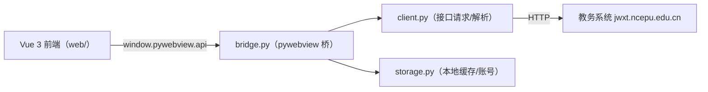
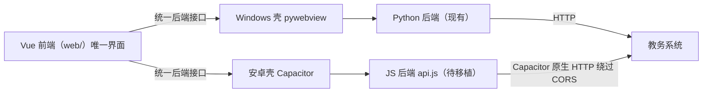

# 架构与技术栈

## 总体架构（当前 Windows 版）

## 未来双端架构（规划）

前端只依赖一组**统一接口**（见下文契约），Windows 由 pywebview 桥提供，安卓由 JS 实现提供。

## 文件职责

| 文件 | 职责 | 备注 |
|---|---|---|
| `main.py` | pywebview 入口；窗口创建；窗口关闭后调用 `api.cleanup_on_close()` | 打包后资源路径用 `_MEIPASS` 处理 |
| `bridge.py` | 前端可调用的全部方法（登录/查询/偏好/用户信息）；错误信息中文化；教学楼/教室名解析 | 核心桥接层 |
| `client.py` | 教务系统所有 HTTP 请求与 HTML/XML 解析；登录加密算法 | 纯后端，不依赖 UI |
| `storage.py` | 相对路径数据目录（`data/`）、SQLite kv、cookie、账号、旧数据迁移 | 每个操作单独开连接（线程安全） |
| `web/index.html` | Vue 模板（登录页、四模块、关于弹窗） | |
| `web/app.js` | Vue 应用：状态、筛选、绩点、排序、日历、自动查询等 | 展示层逻辑在前端 |
| `web/style.css` | 全部样式（浅色扁平风） | |
| `web/vue.global.prod.js` | Vue 3 本地构建（离线可用） | |
| `ui.py` | **旧版 tkinter 界面，已废弃** | 保留作参考，未被打包 |
| `icon.ico` | exe 图标（圆角渐变蓝底 + NCEPU） | 由 Pillow 脚本生成 |
| `build_exe.bat` | PyInstaller 打包命令 | |
| `requirements.txt` | requests / lxml / pyinstaller / pywebview / pillow | |

## 技术栈要点

- **Python 3.13** + requests + lxml
- **pywebview 6.x**（Windows 走 WebView2，依赖 pythonnet / clr_loader）
- **Vue 3**（全局构建版，无打包工具链，直接 `<script>` 引入）
- **PyInstaller**（onefile + windowed + `--add-data "web;web"` + 图标 + pywebview 隐藏导入）

## 前后端接口契约（前端调用方法）

这是前端 `app.js` 对后端的**全部依赖**，未来 JS 移植必须实现相同签名与返回结构。

| 方法 | 参数 | 返回 |
|---|---|---|
| `get_startup()` | 无 | `{online, logged_in(恒 false), username, password, remember}` |
| `login(username, password, remember)` | 3 参 | `{ok, message}` |
| `logout()` | 无 | 无（清 cookie；按 remember 决定是否删账号） |
| `cleanup_on_close()` | 无 | 无（关窗时按 remember 清理） |
| `get_about_hidden()` | 无 | `bool` |
| `set_about_hidden(bool)` | 1 参 | 无 |
| `get_user_info()` | 无 | `{name, sid, className}`（可缺字段） |
| `get_timetable(date_str?)` | 可选日期 | `{rows, current, total, updated, source}` |
| `get_grades()` | 无 | `{rows, updated, source}` |
| `get_exams()` | 无 | `{rows, updated, source}` |
| `get_buildings(campus_name)` | "一校区"/"二校区" | `{buildings: [[id, name], ...], message?}` |
| `query_classrooms(params)` | 条件字典 | `{names, ok, message}` |

说明：
- `rows` 均为二维数组，首行为表头；课表单元格是 `{name, location, attr, credits}` 对象或字符串
- `updated` 为本地缓存时间戳（epoch），前端格式化展示
- `source` 为 `"online"` 或 `"cache"`，前端据此显示“离线缓存”
